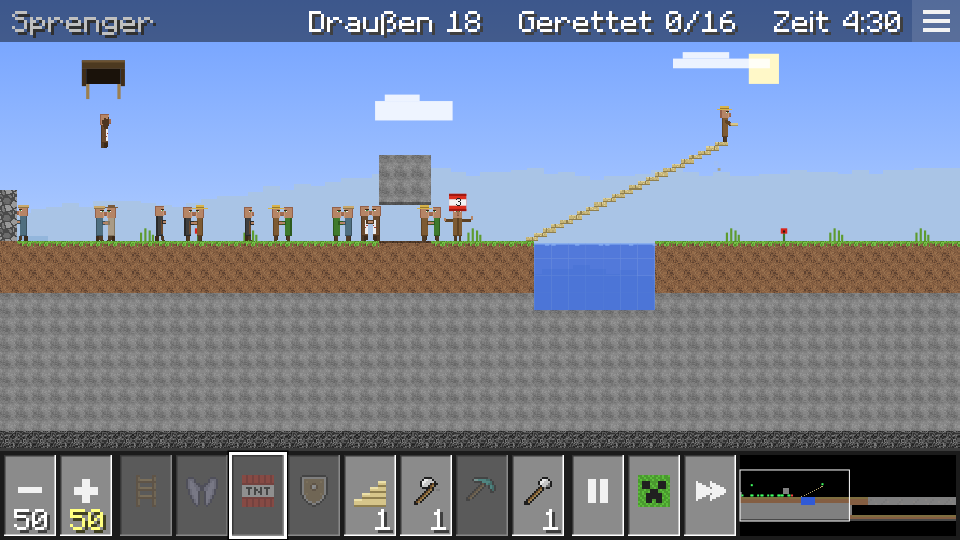
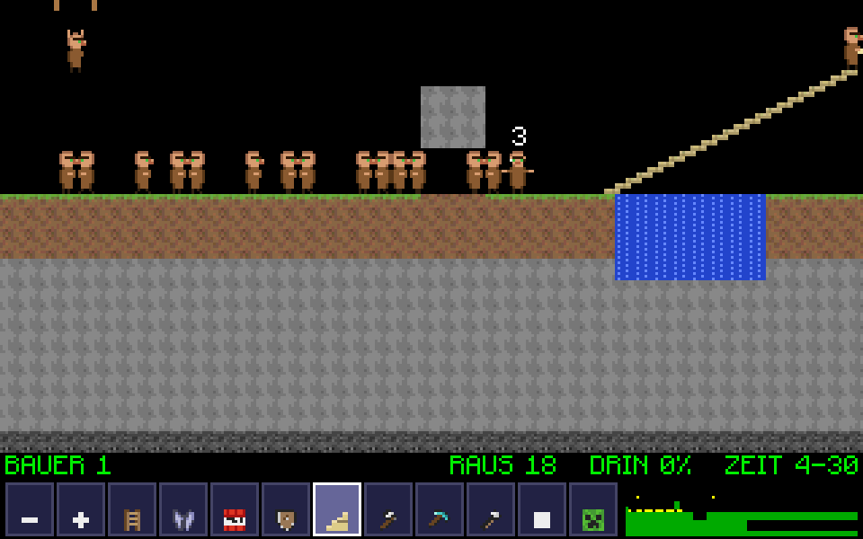
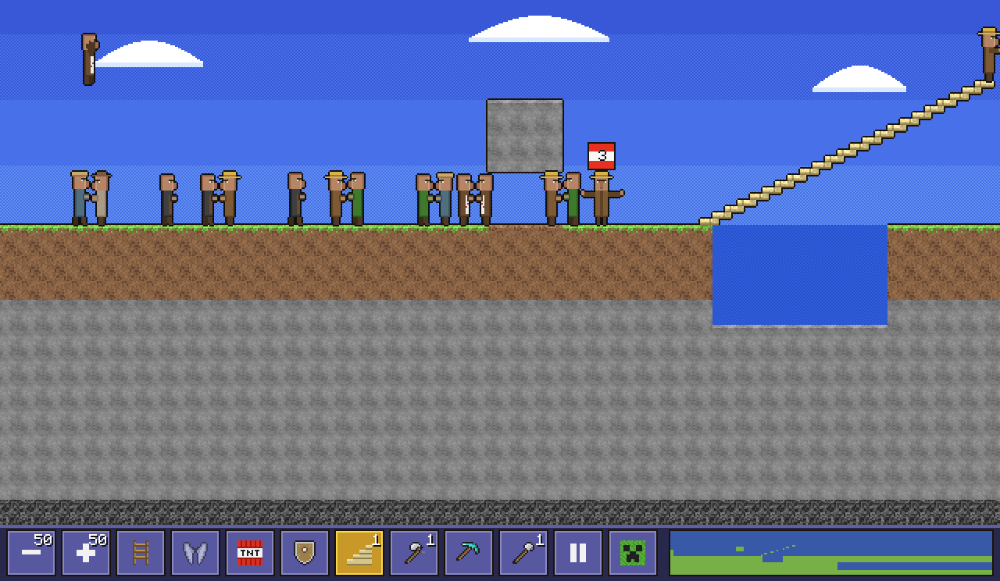
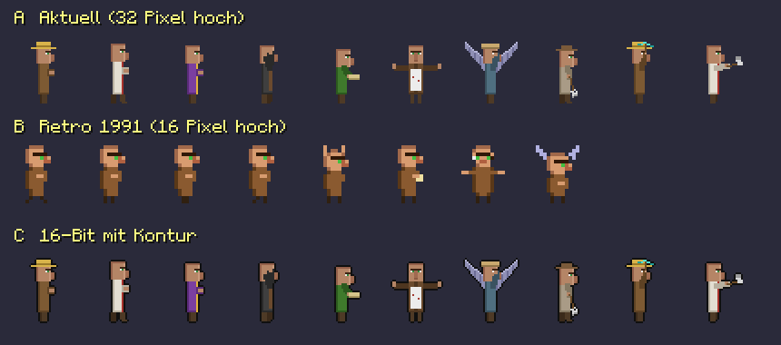

# Stil-Entwürfe

Dieselbe Spielszene (Oberwelt, Level 8, nach 30 Sekunden) in drei Stilen.
Alles ist 2D-Pixelgrafik mit Sprites, nur die Auflösung und der Look unterscheiden sich.

## A – Aktuell

Blocktexturen in 16×16 Pixeln wie im Original, Villager 32 Pixel hoch, Menüs im Stil der Klötzchenwelt.

## B – Retro 1991

Wie die Lemminge damals auf dem Amiga: winzige Figuren (16 Pixel hoch), schwarzer Hintergrund,
grobe 8×8-Blöcke mit Amiga-Farben, grüne Statuszeile, Zahlen über den Fähigkeiten.

## C – 16-Bit

Wie die Konsolenfassungen der 90er: Figuren aus A mit schwarzer Kontur, Gelände mit Umriss
und hellen Kanten, Himmel in Farbstufen mit Raster, bunte Knopfleiste.

## Die Figuren im Vergleich

Laufen, Fallen, Bauen, Blocken, Gleiten, Buddeln, Bergbau, Tunnel – jeweils groß gezeichnet.

Neu erzeugen: `node tools/entwuerfe.mjs` (B, C, Figuren) und
`LEVEL=oberwelt-8 TIMES=30 W=960 H=540 DPR=1 node tools/shot.mjs /tmp/a tools/replay.mjs` (A).
